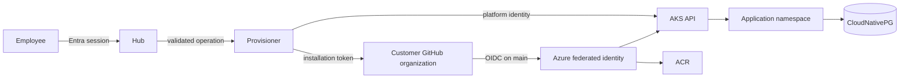

## Control flow

oauth2-proxy validates Entra tokens at NGINX ingress and returns identity headers. Ingress replaces caller headers with those results. Network policy prevents external access to the ClusterIP services. The Hub checks the creator group before recording an operation.

The GitHub App private key stays in Key Vault. External Secrets uses the Hub workload identity to synchronize the three GitHub App values into the Hub namespace. The provisioner exchanges its signed app token for a short-lived installation token, then creates a private repository from the governed template and configures Actions variables.

Generated repositories receive no cluster credentials. Their `main` branch has one federated identity subject. The reusable workflow builds and scans an image, pushes it to ACR, resolves its digest, and updates only the application-owned deployment.

## Lifecycle

`accepted -> provisioning -> ready`

Failures move to `failed` with a retryable operation record. Repeating an idempotency key returns the original operation. Deletion moves `ready -> deleting -> deleted` and removes runtime resources while preserving source.
